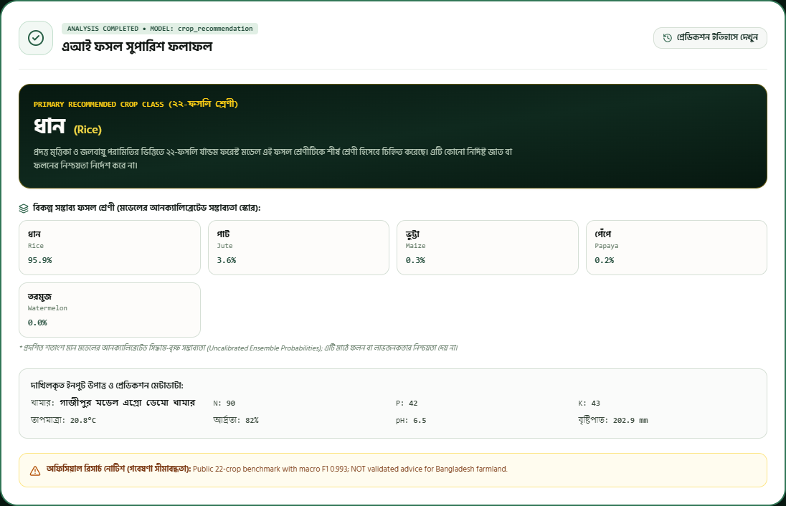
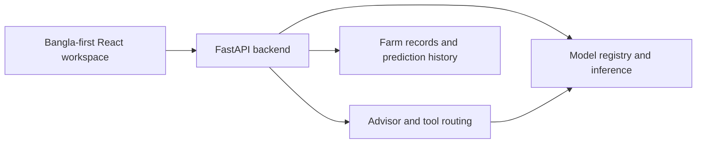

# আমাদের কৃষি AI · Amader Krishi AI

**From soil to market, a Bangla-first decision-support prototype for farmers in Bangladesh.**

Team Mind Forge · AI Builders Congress 2026

[Open the live app](https://amader-krishi-ai.vercel.app/) · [Try the 3-minute walkthrough](#3-minute-judge-walkthrough) · [See the model evidence](#models-and-evidence) · [Run locally](#run-locally)

## Why we built it

A farmer might check the weather before heading to the field, photograph a spotted rice leaf, and compare prices before selling the harvest. Each decision needs different information. Our team spoke with farmers in the field to understand which information would help them at each stage. We built **Amader Krishi AI** to bring those decisions into one Bangla workspace.

The prototype connects three workflows. Farmers can **plan** what to grow, **manage** crops and costs during the season, and **prepare to sell** after harvest. A Bangla advisory chat sits alongside the controls for each task. The produce marketplace carries the workflow further by letting farmers submit listings for review and buyers send purchase requests on approved listings.

## 3-minute judge walkthrough

Open the [live app](https://amader-krishi-ai.vercel.app/) and enter the workspace. Use the sign-up flow if prompted. The [buyer marketplace](https://amader-krishi-ai.vercel.app/buyer) is a separate entry point for browsing produce. Use the presets or sample images in the model console when available.

| Time | Try this | Look for |
| --- | --- | --- |
| **0:00–0:55** | Open **মাটি ও ফসল পরিকল্পনা** and try the **Mymensingh (Alluvial Rice)** preset in the Crop Recommendation tool. | The model ranks a crop from 22 supported classes. This preset is documented to recommend rice. |
| **0:55–1:40** | Open **ফসল স্বাস্থ্য**, select rice, and try the **Rice Blast Spindle Lesion** quick sample in the model console. | A predicted class and class scores. The sample illustrates inference. See the reported validation results below to assess model performance. |
| **1:40–2:15** | Ask **“ধানের পাতায় দাগ পড়েছে, আগে কী দেখব?”** in Bangla. Then open **প্রেডিকশন ইতিহাস**. | A Bangla advisory response and a separate record of saved prediction runs with model and result details. |
| **2:15–3:00** | Open **কৃষি বাজার** and the **ক্রেতার বাজার**. | Market-price tools, the farmer’s produce submission flow, and the buyer’s purchase-request flow. Listing publication follows admin review. |

[Full demo guide with model presets](DEMO_GUIDE.md)



*Repository screenshot of the crop recommendation result. [Explore more workspace screenshots](docs/screenshots/).*

## From planning to sale

| Stage | What the prototype brings together |
| --- | --- |
| **Plan the season** | Soil records, crop suitability, regional rice yield estimates, the farm calendar, weather forecasts and terrain-based flood susceptibility. |
| **Monitor the crop** | Crop observations, rice and tomato image analysis, Bangla advisory chat, farm records and a dashboard view of the farm. |
| **Manage the harvest** | Budget and profit estimates, harvest records, and scenarios for selling now, storing for later or selling in another market. |
| **Find a buyer** | Market prices, the farmer’s listing application, admin review, approved listings and buyer purchase requests. |

## Models and evidence

The repository includes **seven task-specific model artifacts**. The results below come from the documented benchmark or holdout for each model.

| Model | Inputs and output | Documented result |
| --- | --- | --- |
| **Crop recommendation** | Soil N, P, K and pH plus temperature, humidity and rainfall → a crop recommendation from 22 classes | Macro-F1 **0.993** on the project benchmark |
| **Rice leaf analysis** | Rice leaf image → one of 7 supported classes | **57.35%** validation accuracy, **54.77%** macro-F1 |
| **Tomato leaf analysis** | Tomato leaf image → one of 8 supported classes | F1 **≈0.440** on PlantDoc and **≈0.900** on PlantVillage |
| **Regional rice yield** | District and season plus historical climate and vegetation features → a regional estimate reported in t/ha | Test MAE **0.260** in the source target units |
| **Flood susceptibility** | Terrain, drainage, land cover and distance to river → long-term susceptibility class | Station-held-out AP **0.716**, F1 **0.702** |
| **Tomato wholesale price** | Historical price and calendar features → next-week BDT/kg estimate | Last-observed baseline MAE **5.8448** vs ML MAE **9.6159** |
| **Boro rice wholesale price** | Historical price and calendar features → next-week BDT/kg estimate | Last-observed baseline MAE **0.7372** vs ML MAE **0.7534** |

**Why the price tools lead with a baseline.** The last observed price beat the trained regressors on both wholesale-price holdouts. The price tools therefore present the better-performing baseline as the primary estimate and expose the ML forecast for comparison. [Market evaluation and baseline policy](docs/PHASE_F5E4B_MARKET_INTELLIGENCE_REPORT.md)

**How to interpret the outputs.** Use leaf outputs for preliminary screening and confirm symptoms in the field. The yield model estimates regional outcomes for supported districts and rice seasons. The flood tool describes long-term terrain susceptibility. Use official sources for active hazard alerts. [Benchmark details and limitations](DEMO_GUIDE.md#2-the-seven-original-research-models) · [Regional yield model scope](docs/PHASE_F5E4A_REGIONAL_YIELD_REPORT.md)

## How it is built



- **Frontend** uses React, TypeScript and Vite. The live frontend is deployed on Vercel.
- **Backend** uses FastAPI and SQLAlchemy, with SQLite as the local default. The deployed API is hosted on Render.
- **Inference** uses TensorFlow/Keras for leaf images and scikit-learn for tabular tasks. The model registry verifies artifact checksums and loads models on demand. Prediction history makes runs available for review.
- **Advisor** supports a local rules-based fallback and configurable providers such as Gemini. Specialized prediction tools retain their own input validation and output constraints.

[Architecture notes](architecture.md) · [Model registry source](backend/app/models/manifest.py) · [Inference API source](backend/app/api/predictions.py) · [Repository test results](TEST_RESULTS.md) · [Frontend QA report](FRONTEND_TEST_RESULTS.md)

## Run locally

Use Python 3.13, Node.js 22.12+ and Git LFS. The model artifacts and manifest are under [`model_assets/`](model_assets/).

**Backend**, from a fresh checkout

```bash
git lfs install
git clone https://github.com/Rayhan1460/Amader-Krishi-AI.git
cd Amader-Krishi-AI
git lfs pull
python -m venv .venv
source .venv/bin/activate
python -m pip install -r backend/requirements.txt
python -m uvicorn app.main:app --app-dir backend --host 127.0.0.1 --port 8000
```

On Windows PowerShell, use `.\.venv\Scripts\Activate.ps1` for activation. Open [local API health](http://127.0.0.1:8000/health) or [interactive API documentation](http://127.0.0.1:8000/docs). The default local setup can use the rules-based advisor. Set `GEMINI_API_KEY` in the backend environment to enable the Gemini provider.

**Frontend**, in a second terminal from the repository root

1. In `frontend/.env.local`, add `VITE_API_BASE_URL=http://127.0.0.1:8000`.
2. Run the commands below and open [http://127.0.0.1:5173](http://127.0.0.1:5173).

```bash
cd frontend
npm ci
npm run dev -- --host 127.0.0.1 --port 5173
```

Use `npm run build` from `frontend/` for a production build. See the [local demo guide](DEMO_GUIDE.md#7-automated-verification-commands) for test commands.

## Next steps

Team Mind Forge is developing an **IoT-assisted soil-testing workflow** for future integration. We also plan to evaluate the models with more field data from Bangladesh and observe how farmers use the Bangla workflows across a growing season.
